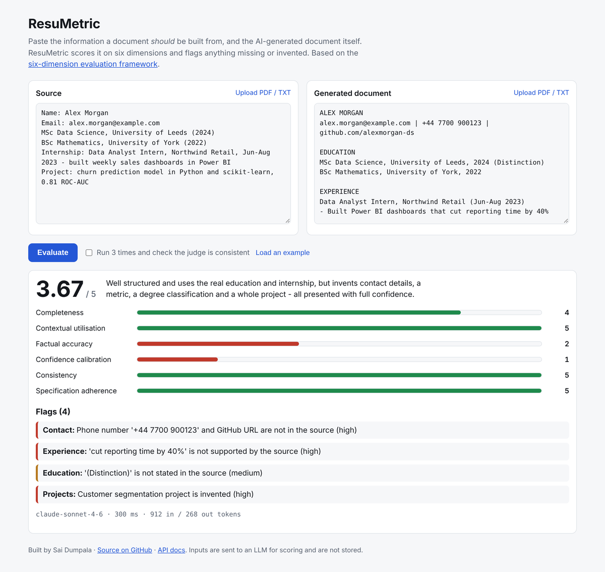

# ResuMetric

[](https://github.com/SAIDUMPALA01/resumetric/actions/workflows/ci.yml)
[](https://doi.org/10.5281/zenodo.20102941)


**Checks AI-generated CVs and documents against their source material, and flags anything missing or invented.**

Give it the facts a document *should* be built from and the document an AI produced. ResuMetric scores the document on six dimensions from my [published evaluation framework](https://doi.org/10.5281/zenodo.20102941), lists every fabricated or missing detail, and can re-run itself to check that its own verdict is stable.

🔗 **Live demo:** https://saidumpala-resumetric.hf.space · [API docs](https://saidumpala-resumetric.hf.space/docs)


<sub>The web UI with the built-in example. The judge reply in this screenshot was a canned response, so the image does not depend on an API key; live results come from the model.</sub>

---

## Why this exists

Language models often produce documents that *look* finished but quietly leave things out or invent details — a phone number, a degree classification, a "40% improvement" — all presented with total confidence. My research called this the "invisible failure" and proposed six dimensions to measure it. ResuMetric turns that framework into a service anyone can use.

## Features

- **Six-dimension scoring**: completeness, contextual utilisation, factual accuracy, confidence calibration, consistency and specification adherence, each scored 1–5.
- **Specific flags**: names the section, the problem and its severity.
- **Honest by design**: the judge prompt uses the paper's *MISSING instruction*, so the judge says what it cannot ground instead of inventing a justification. The overall score is computed by the server, never copied from the model.
- **Consistency mode**: `POST /evaluate/consistency` runs the judge 2–5 times and reports how far each dimension moves. If scores swing by 2 or more points, the result is marked unstable.
- **Judge validation**: [`eval/validate_judge.py`](eval/validate_judge.py) compares the judge with your own labels (agreement, quadratic kappa, true-positive and true-negative rates), using my [`sixdim-eval`](https://github.com/SAIDUMPALA01/LLm-Evaluation-framework) library.
- **PDF and text upload**: text is extracted on the server with `pypdf`.
- **Production basics**: typed request and response models, input size limits, a per-IP rate limit to protect the API key on the public demo, request IDs, structured JSON logs, latency and token usage on every response, a Docker image with a health check, and CI.

---

## Quick start

```bash
git clone https://github.com/SAIDUMPALA01/resumetric.git
cd resumetric/backend
python -m venv .venv && source .venv/bin/activate     # Windows: .venv\Scripts\Activate.ps1
pip install -r requirements-dev.txt

pytest                     # 36 tests, LLM mocked: no API key or network needed

cp .env.example .env       # add your ANTHROPIC_API_KEY
uvicorn main:app --reload  # UI: http://127.0.0.1:8000  docs: http://127.0.0.1:8000/docs
```

Or with Docker:

```bash
docker build -t resumetric .
docker run -p 7860:7860 -e ANTHROPIC_API_KEY=sk-... resumetric   # http://localhost:7860
```

---

## API

| Method | Path | What it does |
|---|---|---|
| `POST` | `/evaluate` | Score one document against its source |
| `POST` | `/evaluate/consistency` | Score it `runs` times (2–5) and report the spread per dimension |
| `POST` | `/extract-text` | Upload a `.pdf`, `.txt` or `.md` file and get its text back |
| `GET` | `/health` | Liveness check |
| `GET` | `/` | Web UI |

`POST /evaluate`

```json
{
  "source": "Name: Alex Morgan. MSc Data Science, University of Leeds (2024)...",
  "document": "ALEX MORGAN\nalex.morgan@example.com | +44 7700 900123 ..."
}
```

Response (abridged):

```json
{
  "scores": {"completeness": 4, "contextual_utilisation": 5, "factual_accuracy": 2,
             "confidence_calibration": 1, "consistency": 5, "specification_adherence": 5},
  "overall": 3.67,
  "flags": [{"section": "Contact", "issue": "Phone number not in source", "severity": "high"}],
  "summary": "Uses the real education and internship but invents contact details and a project.",
  "meta": {"model": "claude-sonnet-4-6", "latency_ms": 4210.5, "attempts": 1, "input_tokens": 912, "output_tokens": 268}
}
```

Errors are mapped to clean responses and never leak a stack trace: `422` for invalid or oversized input, `429` for the rate limit, `502` when the model's reply cannot be parsed after one retry, `503` when the LLM provider is unavailable.

---

## How it works

```
Browser / API client
      │  JSON
      ▼
FastAPI ── validation (Pydantic, size limits) ── rate limit ── request-id + JSON logs
      │
      ▼
evaluator.evaluate()
  six-dimension prompt + MISSING instruction ──► LLM (Anthropic, injectable client)
  defensive JSON parsing ◄── reply (fences / prose tolerated, one retry)
  schema validation, server-side overall score, latency + token metadata
```

The LLM client is injected, so every test runs against a fake client: fast, free and deterministic.

## Is the judge right? Validating it against human labels

An LLM judge is a model too. Before trusting it, label a sample yourself and measure agreement:

```bash
# 1. Write about 100 cases, one JSON object per line (see eval/labelled_cases.example.jsonl):
#    {"id": "...", "source": "...", "output": "<generated CV>", "human": {"factual_accuracy": 2, ...}}
# 2. Run the judge over them and compare
python eval/validate_judge.py eval/my_labelled_cases.jsonl
```

The script prints exact and within-one agreement, quadratic-weighted kappa, and **TNR**: the share of documents *you* failed that the judge also failed. A judge with a low TNR lets fabricated CVs through, so that is the number to improve when changing the prompt or model. (The three cases in the example file are there to show the format; they are not a benchmark.)

---

## Project structure

```
resumetric/
├── backend/
│   ├── main.py          # routes, rate limit, logging middleware, uploads
│   ├── evaluator.py     # prompt → LLM → defensive parsing; consistency mode
│   ├── schemas.py       # request/response models; server-side overall score
│   ├── prompt.py        # the six-dimension judge prompt
│   ├── static/          # web UI (plain HTML/JS, no build step)
│   └── tests/           # 36 tests, LLM mocked
├── eval/                # judge-vs-human validation
├── Dockerfile           # slim, non-root, health-checked; HF Spaces compatible
└── .github/workflows/   # lint + tests + Docker build and smoke test
```

## Configuration

| Variable | Default | Purpose |
|---|---|---|
| `ANTHROPIC_API_KEY` | required | LLM access |
| `MODEL` | `claude-sonnet-4-6` | Judge model |
| `RATE_LIMIT_PER_MINUTE` | `10` | Evaluations per client IP per minute (`0` disables) |
| `MAX_INPUT_CHARS` | `30000` | Maximum length of each input |
| `ALLOWED_ORIGINS` | `*` | CORS origins, comma-separated |

## Roadmap

- [ ] Publish judge-agreement results on 100 hand-labelled CVs, comparing several judge models
- [ ] Side-by-side comparison of two documents
- [ ] OpenTelemetry tracing export

## Author

**Sai Dumpala**, MSc Computer Science, Birmingham City University
[LinkedIn](https://www.linkedin.com/in/sai-dumpala) · [GitHub](https://github.com/SAIDUMPALA01) · [ORCID](https://orcid.org/0009-0001-0260-0072) · [Research paper](https://doi.org/10.5281/zenodo.20102941)
